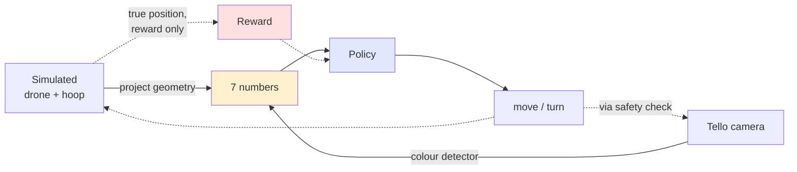

# Drone Soccer: RL Hoop Traversal

## Context

Final year undergraduate RL project. Three people, under four weeks. The brief requires
reinforcement learning and a user interface. The deliverable is a real DJI Tello EDU drone
that finds a hoop and flies through it, inside a fixed netted cage.

The drone learns in a fast simulator, then flies for real. This works because the policy
sees **seven numbers describing how the hoop looks**, not camera images. The simulator has
to copy seven numbers, not a photograph.

Work runs as **three parallel tracks**, so the real drone flies early and nobody waits:

- **Track A (me):** simulator, training, randomisation, search.
- **Track B (teammate B):** safety, flight loop, measurements, detector, real flights.
- **Track C (teammate C):** operator interface and report.

## Mission update (2026-09-25): laps

The mission is now **continuous laps**, not a single pass:

1. Take off from a pad in a corner of the cage. The pad sits 0.25 m from both walls and
   faces in.
2. Find the hoop. Its height and position are unknown, so the policy searches: it turns,
   climbs or descends.
3. Fly through the hoop **front to back**.
4. Fly **round the outside** back to the front, then pass again, until the battery check
   lands the drone.

**Rules**

| Event | Reward | Episode |
|---|---|---|
| Pass front to back | +25 | keeps going |
| Back through the hole | -10 | ends (`wrong_way`) |
| Crossing the plane outside the ring | nothing | keeps going: this is how the drone gets round |
| Hit / left the cage | -10 | ends |

**Other changes**

- **Progress reward:** behind the hoop, progress pays for getting closer to a waypoint
  beside the hoop rather than to its centre.
- **Episode length:** 60 s in training, and hitting it counts as a cut-off, not a failure.
- **Search comes before randomisation:** the old A4 now goes ahead of A3.
- **Geofence:** now 0.15 m from the net, because 0.25 m would put the pad start right on
  the fence.

**Front marker.** The hoop looks the same from both sides, so the policy needs to see which
side it's on. A disc on the noodle's front face at 6 o'clock does it, because the noodle
hides it from behind.
- Colour the front of the disc **solid magenta or pink**.
- Colour its back black or hoop-blue, because the back shows below the noodle.
- Wrap the blue hanger bar in black tape, or it skews the ellipse fit.
- **B3 detects the marker by colour, not the plus.** At 480×360 the plus is only 2–3 px
  thick.

## How it fits together



The policy cannot tell whether the seven numbers came from the simulator or a real camera.
That is the whole trick.

The true hoop position exists only in the simulator, only to compute reward. The policy
never receives it, so it must find the hoop by looking. Expect this question in the oral.

## The seven numbers (now eight)

Freeze as `src/contract.py` in stage 0. Everything depends on it. The laps mission added an
eighth field, `marker`, so the policy can tell front from back.

| Field | Meaning |
|---|---|
| `u`, `v` | Where the hoop sits in the image |
| `major` | How big it looks, so how far away it is |
| `ratio` | How squashed the ellipse is, so the hoop's angle |
| `sin_2t`, `cos_2t` | Which way the ellipse leans |
| `visible` | 1 if found, 0 if not |
| `marker` | 1 if the front marker is seen next to the hoop, 0 if not |

- **Lean uses 2θ, not θ.** An ellipse at θ and θ+180° is the same ellipse, so plain
  `sin θ, cos θ` would jump as the ellipse rotates. Scale both by `(1 - ratio)`, because
  a near-circle has no meaningful lean.
- **When `visible = 0`, the other six are all 0.** Frozen in the contract so the detector
  and simulator agree.

The policy gets these for 9 frames spread over the last 2.4 s, plus its own last 3
actions (84 numbers). Stacking lets it infer its own speed, so a plain MLP works with no
recurrent network.

## How the tracks meet

| Handoff | From | To | Why |
|---|---|---|---|
| Frozen contract, `calib.npz` | Stage 0 (all) | A, B | Everything depends on them |
| Measured delay, frame rate, step responses | B2 | A3 | Randomise around real values, not guesses |
| Detector noise and dropout logs | B3 | A3 | Same |
| Randomised policy | A3 | B4 | The first real policy flight |
| First flight result | B4 | A4 | Decide whether search is worth attempting |

## Stage 0: Decide and measure (all, 1-2 days)

1. Measure the cage.
2. **Fix the hoop diameter**, around 60-80 cm. This blocks the simulator. The colour does not.
3. Freeze `contract.py`.
4. Calibrate the camera: chessboard photos through the Tello stream, `cv2.calibrateCamera`,
   commit `calib.npz`.
5. Lay out mission pads and record their positions.
6. Buy magenta and cyan pool noodles. The cage has a yellow ceiling, black netting and
   white pipe, so avoid yellow, orange, white and black.

**Done when:** cage dimensions, hoop diameter, frozen contract, `calib.npz` and a pad layout
exist.

**Check now:** the Tello needs ~1.5 m to speed up and stop. If the cage's longest axis is
under about 3 m, reduce how far the hoop can be placed.

---

## Track A: Simulator and learning (me)

### A1: Simulate the hoop (3-4 days)

A Gymnasium environment producing the same seven numbers from geometry, rendering nothing.

- **Drone:** position, velocity, heading. Commands set a target velocity reached smoothly,
  `v += (v_cmd - v) * dt / tau`. No rotor physics needed at 0.4 m/s.
- **Observation:** take ~32 points around the hoop's outer edge in 3D, project through the
  calibrated camera matrix, **drop points behind the camera or outside the image**, and fit
  with **the same `cv2.fitEllipse` call the detector uses**. The clipping matters: the real
  detector only sees the part of the hoop in frame.
- **Reward:** mostly progress along the hoop's axis, through it. Small penalties per step
  and for the hoop not being visible. Terminal bonus for passing through, penalty
  for hitting the hoop or leaving the cage. **Do not reward closeness to the hoop centre**,
  or the drone hovers at the hoop instead of flying through.
- **Commands are body-frame**, so heading changes what "forward" means. Rotate the command
  by the current heading before integrating. Easiest bug to introduce, and the symptom is a
  drone that circles the hoop.

Also write `baseline.py`: a ~30 line proportional controller using the same seven numbers.
It proves the task is solvable and becomes the report's comparison figure.

**Done when:** unit tests pass (hoop ahead gives `u, v = 0` and `ratio = 1`; a 45 degree
hoop gives `ratio` near 0.7; `major` scales as 1/distance) and the baseline passes through
most of the time.

**Gate:** if the baseline cannot do it, the reward or geometry is wrong. Fix before touching
RL.

### A2: Learn to fly through (2-3 days)

Start deliberately easy: hoop always in view, no yaw, no randomisation. SAC from
Stable-Baselines3. Nothing renders, so training takes minutes on CPU and runs in Colab.

**Done when:** over 90 percent pass rate on easy episodes.

**If SAC will not learn** but the baseline works, the reward is wrong, not the algorithm.
Check reward scale, then try PPO.

### A3: Survive reality (2-3 days)

Needs B2's measurements. First fit the simulator's delay, response speed, command scaling
and drift to B's step-response logs (`sysid.py`). Then randomise around the fitted values.

Start with the three that matter most:

- **Command delay**, around the measured value, e.g. 1-4 steps. Biggest single gap.
- **Timestep**, e.g. 8-12 Hz, because WiFi is not steady.
- **Detector noise and dropout**, matching B3's logs.

Add these only if the delay sweep or first flight shows you need them:

- Response speed and command scaling, ±30 percent.
- Constant drift, for air currents and calibration error.
- Hoop diameter, ±10 percent.
- Camera tilt with acceleration. The Tello pitches forward to accelerate, shifting the hoop
  down in frame. It correlates with the action, so it biases learning rather than just
  adding noise.

**Done when:** over 90 percent pass rate with randomisation on, and the pass rate does not
collapse when delay is swept 0 to 6 steps. That sweep is the best predictor of real flight.

**If B2 is late:** randomise around guesses (100-300 ms delay), hand the policy to B, and
refit once the logs arrive.

### A4: Learn to search (3-4 days, droppable, only after B4's first flight)

Add yaw so the drone can turn to find a hoop it cannot see. The strongest RL contribution
available, and the honest reading of "the drone must find the hoop". It comes after the
first real flight so it cannot delay the demo.

The hard part is exploration, not control: **if the hoop starts behind the drone, every
observation reads `visible = 0` and the reward is flat**, so random exploration almost never
finds it. Both of these are needed:

1. **A curriculum on starting angle.** Begin with the hoop centred, then widen as the pass
   rate rises: 15, 45, 90, 180 degrees. ~20 lines, and the staircase makes a good figure.
2. **A small bonus each time the hoop becomes visible.** Penalise turning rate and end the
   episode after about two full turns, or the drone learns to spin and farm the bonus.

Model turning blur: detector dropout must rise with turning rate (B measures it in B3).
Unmodelled, the policy spins fast in simulation and loses the hoop instantly in reality.

**Done when:** the curriculum reaches 180 degrees with the pass rate holding.

**Go/no-go:** if the curriculum stalls before 90 degrees, **drop it.** Mask the yaw action
and ship A3. "The hoop starts in view" is a respectable scope statement.

---

## Track B: Hardware (teammate B)

### B1: Safety and flight loop (2-3 days, starts after stage 0)

1. **Safety first.** Keyboard kill switch, height limit, battery check, geofence. Nothing
   flies autonomously before this exists.
2. **Flight loop.** Decode video on a separate thread into a "latest frame" slot; the
   control loop grabs it without blocking. Use `send_rc_control` only, never `go` or
   `move_*` in the loop, because those block until the drone replies. Run on a deadline
   timer, not `sleep(0.1)`. Log every tick, including pad position.

**Done when:** the drone hovers, takes keyboard commands through the loop, and the kill
switch works every time.

### B2: Measure the drone (1-2 days)

1. **Command delay and loop rate.** Does the laptop hold 10 Hz? 5 Hz is fine if the
   simulator matches.
2. **Step-response flights.** Scripted step inputs on each axis, about 15 short runs, with
   mission pad positions logged. Hand the logs to A for `sysid.py`.
3. **Floor check.** Does the downward sensor hold a steady hover over this floor?

**Done when:** A has delay, rate and step-response logs.

### B3: See the hoop (2-3 days)

Classical computer vision, no machine learning. About 15 lines of OpenCV:

1. Shrink to 480x360 and blur. The netting is a fine grid that speckles the mask without it.
2. Convert to HSV and `cv2.inRange` on the noodle colour to get a black-and-white mask.
3. Morphological open then close. Close rejoins the arcs the netting cuts the hoop into.
4. `findContours`, then `cv2.undistortPoints`, then `cv2.fitEllipse` from `contract.py`.

**Three traps:**

- **Do not use the largest contour.** Merge points from *all* contours above a minimum area
  and fit one ellipse to the union. The arcs lie on the same ellipse.
- **Fit the noodle's outer edge**, matching the simulator.
- **A hoop seen edge-on cannot be detected.** Hence hoop angles limited to about ±40 degrees.

Magenta is most distinctive but its hue wraps OpenCV's 0/180 boundary and needs two
`inRange` calls. Cyan is one range but competes with the blue-lit doorways. Test both, at
two times of day.

**Done when:** over 95 percent detection on cage footage where a person can see the hoop.
Log dropout rate, jitter and frame rate for A3, plus dropout at several turning speeds in
front of a stationary hoop for A4.

### B4: Fly the policy (3-4 days)

Score and reset by hand first, then automate with pads if they prove reliable.

**Done when:** the drone passes through the hoop repeatably from varied hoop positions.

**When it fails:** log the real seven numbers and compare against the simulator for the same
geometry. Whatever diverges shows which randomisation range was too narrow. A refits and
retrains; B flies again.

### Mission pads

Their main job is **position logging** for B2's step responses: without them the response
fit relies on drifting IMU estimates. Automatic scoring and `go x y z mid` resets are
optional extras (never inside the control loop). Pads work best 0.3 to 1.2 m below the
drone and detection is patchy, so keep manual scoring and reset as the fallback.

---

## Track C: Interface and report (teammate C, whole project)

Template section 2.3 grades the interface directly. An operator console: live feed with the
detection drawn on it, the seven numbers, the chosen action, and arm and kill buttons. It
doubles as the safety interface and the demo video. Build it on B1's flight loop as soon as
that exists.

Report sections I own: 1.4 Environment, 2.2 Architecture, 3.1 Experimental Settings, 3.3
Results. The diagram above covers 2.1.

## Results worth producing

| Result | Shows |
|---|---|
| Against the baseline controller | The RL was worth doing |
| Pass rate against command delay | Whether real flight is plausible |
| With and without randomisation | Why A3 exists |
| Real flight pass rate | Sim-to-real transfer works |
| Pass rate by starting angle | Search works (A4) |

## Assumptions

Unverified ones are marked, because the plan changes if they are wrong.

1. The cage is big enough for an approach run. **Unverified, biggest early risk.** Stage 0.
2. Command delay is 100-300 ms and the laptop holds 10 Hz. **Unverified.** B2.
3. The downward positioning sensor works over this floor. **Unverified.** B2.
4. Lighting is roughly constant. **Doubtful**, the cage has windows. B3 tests two times of day.
5. The hoop colour is unique in the scene. **Unverified.** B3.
6. Mission pad detection is reliable enough for position logging. **Unverified**, hence the
   manual fallback.
7. `cv2.fitEllipse` on projected points matches the same call on real contours.
   **Unverified.** Checked by comparing A1's output to B3's on the same geometry.
8. The hoop is planar, fixed during an episode, angled within about 40 degrees. A hoop at
   +30 and −30 degrees looks nearly identical; the policy tells them apart only by parallax
   across stacked frames. If pass rate plateaus on angled hoops, narrow the range to ±25.
9. A crash into the net cannot be detected onboard. Episodes end on operator stop, geofence
   or timeout.
10. The gap between simulator and reality is mostly delay, dynamics and detector noise, not
    appearance. **The foundation of the approach**; it holds because the observation is
    seven numbers.
11. About 20 real episodes are enough to fit simulator parameters, but nowhere near enough
    to fine-tune by gradient descent. Real flights buy parameters, not training.
12. The noodle hides the front marker from behind, up to about 70° off the hoop's front.
    **Unverified.** Check by eye from behind and the sides; the value is
    `Hoop.marker_max_angle_deg`.
13. Randomisation ranges bracket reality. If not, transfer fails and more training will not
    help. **Main technical risk**, reduced by measuring first in B2.

## If time runs short

Cut in this order. Each line still leaves a complete project.

1. Drop pad scoring and reset, but **keep pad position logging**.
2. Drop A4. Ship the policy with the hoop starting in view.
3. Shrink the hoop placement range and fix the hoop angle to face the drone.
4. Last resort: demo the baseline controller on hardware and the RL policy in simulation,
   and say so plainly in the report.

## Stack and files

`gymnasium`, `stable-baselines3`, `numpy`, `opencv-python`, `djitellopy`. No Gazebo, no ROS,
no Isaac: each costs more setup time than it returns here.

```
src/contract.py    the seven numbers, shared ellipse code   [all, stage 0]
src/sim.py         Gymnasium environment                    [A1]
src/baseline.py    proportional controller                  [A1]
src/train.py       SAC training                             [A2-A4]
src/sysid.py       fit simulator to real logs               [A3]
src/evaluate.py    result plots                             [A2-A4]
src/safety.py      kill switch, limits                      [B1]
src/fly.py         real flight loop                         [B1, B4]
src/detect.py      colour detector                          [B3]
src/gui.py         operator console                         [C]
notebooks/training.ipynb   Colab submission, imports from src/
```
